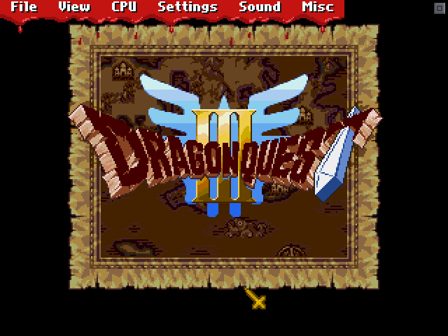
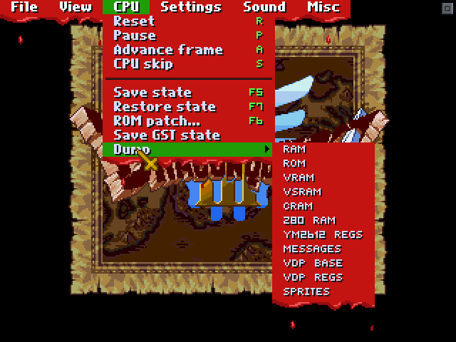
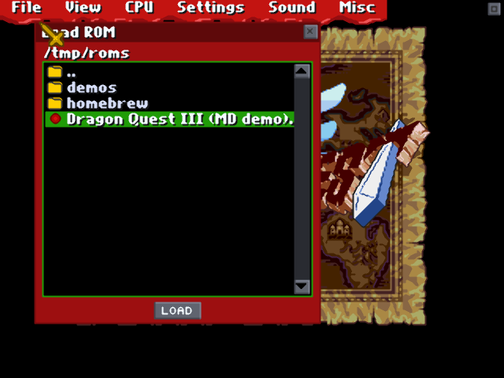
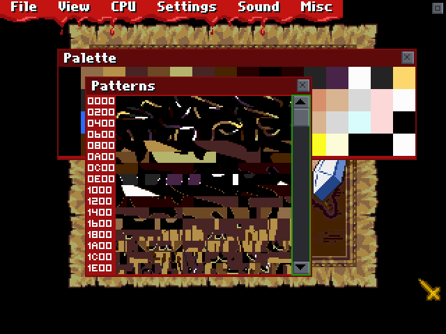
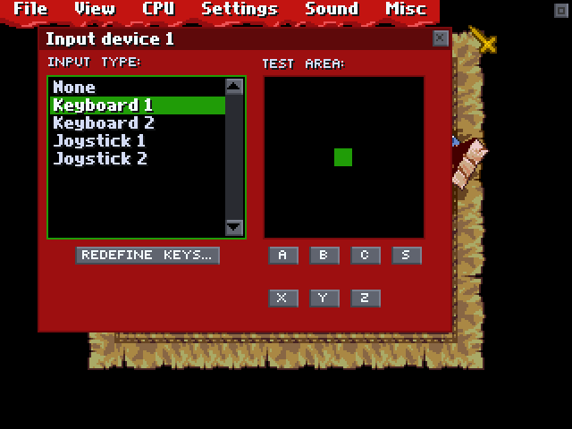
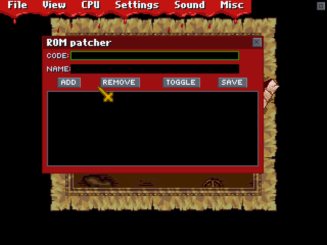
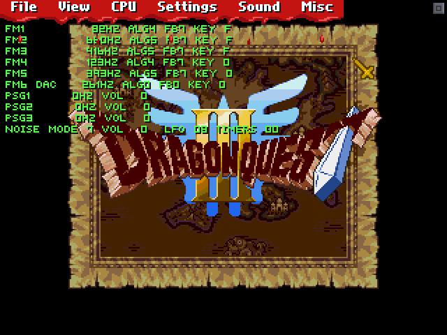
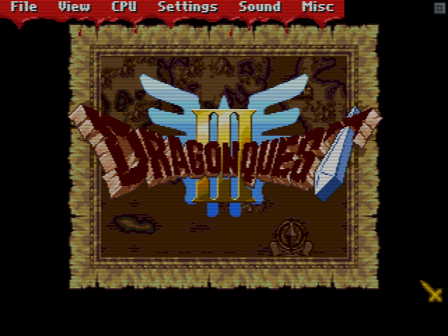
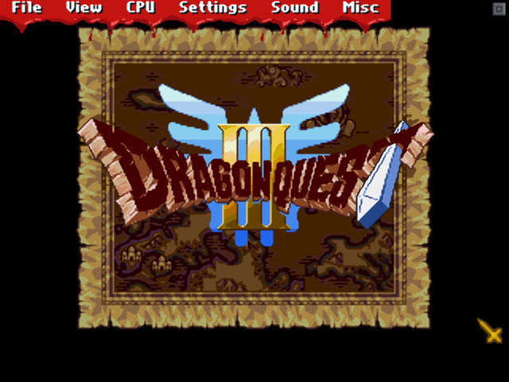

# Genecyst revival

*A tribute to the emulator that changed our lives forever in the Mega Drive scene.*

In 1997 Bloodlust Software (Sardu and Icer Addis, the people behind NESticle)
released **Genecyst**, a DOS Sega Genesis / Mega Drive emulator with a
personality of its own: a windowed GUI drawn right over the game, a menu bar
dripping blood, a golden cross for a mouse pointer, save states on F5/F7, Game
Genie patches, PCX snapshots, GYM sound logs. For many of us it was the first
time a Mega Drive game ran on a PC, and the way it looked and felt is burned
into memory.

The source code was never released. This project rebuilds Genecyst from the
outside in, pixel by pixel, on top of a modern emulation core, so it can run on
today's machines and keep being what it was.

**Download the latest build:**
[**Windows 64-bit (zip)**](https://github.com/junkatana/genecyst-revival/releases/latest/download/genecyst-windows-x86_64.zip) ·
[**Linux x86_64 (tar.gz)**](https://github.com/junkatana/genecyst-revival/releases/latest/download/genecyst-linux-x86_64.tar.gz) ·
[all releases](https://github.com/junkatana/genecyst-revival/releases)

## This is not the original Genecyst

No line of the original program runs here. Genecyst's source code was lost with
Bloodlust Software, and its DOS executable only runs under DOSBox. **Genecyst
revival** is a brand new program that borrows the *experience* of the original,
not its code:

* **Emulation** is done by [Genesis Plus GX](https://github.com/ekeeke/Genesis-Plus-GX),
  Eke-Eke's open-source Mega Drive / Genesis core, known for its accuracy. It is
  vendored as a static library with four small, documented patches (layer
  toggles, DAC mute, PSG write hook, VDP register access for GST import). The
  1997 Genecyst had its own 68000, Z80 and VDP written in assembly; those are
  gone, and with them its glitches and limitations (no shadow/highlight, no
  interlace). Games that never worked in Genecyst work here.
* **Window, video, audio and input** come from SDL2, so the program runs on
  Linux and Windows (and should build anywhere SDL2 does).
* **Everything you see** was reimplemented from the outside: the GUI toolkit,
  the two bitmap fonts, the dialogs, the menus, the colours and the animations
  were measured on the original running under DOSBox, pixel by pixel, and the
  small bitmaps (icons, arrows, check marks, the arrow pointer) and the VGA
  palette were decoded from the resource container embedded in `GENECYST.EXE`.
  The golden cross pointer of the early builds was redrawn from a screenshot.
* **Your old files keep working**: `.GS0`–`.GS9` save states written by the
  original (or by Gens, which adopted the same GST layout), `.GSV` SRAM and
  `.PAT` patch lists load as they are.

### The idea behind the revival

For a whole generation Genecyst *was* the Mega Drive on a PC. The point of this
project is to preserve that feeling, not just the games: open it and it looks,
sounds and behaves like 1998, the hotkeys are in your fingers, the menu still
bleeds. Underneath, a modern core makes it accurate and compatible, and a few
careful additions (filters, auto-hiding GUI, controllers, fullscreen) make it
pleasant to use today without changing its character. Every change is checked
against the original, screenshot by screenshot, and the reference material is
kept in the repository so anyone can verify or improve the reconstruction.

## What is reproduced

Everything measured against the original running under DOSBox, or extracted
from the bitmaps and tables embedded in `GENECYST.EXE`:

* the in-screen GUI: menu bar with the animated blood drips, dropdown menus and
  submenus, draggable windows, list boxes, scroll bars, text fields and buttons,
  with the original palette and both bitmap fonts;
* all six menus, item by item, with the original hotkeys (Alt+letter, F-keys);
* the dialogs: Load ROM, Messages, Palette, Patterns, Layer toggles,
  Directories, ROM patcher (Game Genie and raw `AAAAAA:VVVV` codes, `.pat`
  files), Set resolution, Input device (test area, key redefinition),
  Genesis Timing, About;
* CPU > Dump of RAM, ROM, VRAM, VSRAM, CRAM, Z80 RAM, YM2612 registers, VDP
  state and sprites;
* the file formats: `.GS0`–`.GS9` save states (Genecyst/Gens **GST** files load
  and can be written back), `.GSV` SRAM, `.PCX` snapshots, `.GYM` and `.WAV`
  logs, `.PAT` patch lists, the same directories and command-line options;
* the virtual DOS screen resolutions (256x224 … 640x480) and the little
  maximize box at the right end of the menu bar.

## What is new

* Video filters (View > Filter or `-filter`): Scale2x, 2xSaI, Super 2xSaI,
  Super Eagle, Scanlines, TV, CRT.
* The GUI hides itself after 3 seconds so you can play; moving the mouse or
  pressing Esc brings it back (Misc > Auto hide GUI, `-noautohide`).
* Fullscreen (Alt+Enter), window scale, USB game controllers, a `genecyst.cfg`
  written on exit.

| | |
|---|---|
|  |  |
|  |  |
|  |  |
|  |  |

## Curious about the Dragon Quest III screenshots?

Yes, that is Dragon Quest III running on a Mega Drive. It is a demo of a fan
port in progress by the author of this project. If you want to follow that
work (and other Mega Drive experiments), find me at:

* X / Twitter: https://x.com/junkatanagames
* YouTube: https://www.youtube.com/@junkatana

## Download

Direct links to the latest release (they always point to the newest version):

* **Windows (64-bit):** [genecyst-windows-x86_64.zip](https://github.com/junkatana/genecyst-revival/releases/latest/download/genecyst-windows-x86_64.zip)
  — unzip anywhere and run `genecyst.exe` (SDL2.dll is included). Put your
  ROMs in any folder and use File > Load ROM, or drop a ROM on the window.
* **Linux (x86_64):** [genecyst-linux-x86_64.tar.gz](https://github.com/junkatana/genecyst-revival/releases/latest/download/genecyst-linux-x86_64.tar.gz)
  — needs the SDL2 runtime (`sudo apt install libsdl2-2.0-0` on Debian/Ubuntu),
  then `./genecyst game.bin`.

Older versions and release notes: [Releases](https://github.com/junkatana/genecyst-revival/releases).

Every push also produces development builds under
[Actions](https://github.com/junkatana/genecyst-revival/actions) (GitHub login
required to download those).

## Build

Linux:

    sudo apt install build-essential cmake ninja-build libsdl2-dev zlib1g-dev
    cmake -S . -B build -G Ninja -DCMAKE_BUILD_TYPE=Release
    ninja -C build
    ./build/genecyst [-scale 3] [-filter crt] [-romdir DIR] game.bin

Windows: the GitHub Actions workflow builds a 64-bit `genecyst.exe` with MSYS2
(MinGW-w64 + SDL2) on every push; download it from the Actions artifacts. To
build locally, install MSYS2, `pacman -S mingw-w64-x86_64-{gcc,cmake,ninja,SDL2,zlib,pkgconf}`
and run the same cmake/ninja commands from a MINGW64 shell. A
`cmake/mingw-w64.cmake` toolchain file is provided for cross-compiling from
Linux.

## Keys (same as the original)

| Key | Action |
|-----|--------|
| Esc | hide / show the GUI |
| Alt+L | Load ROM |
| F1 | Messages window |
| F5 / F7 | save / restore state in the current slot |
| F6 | ROM patcher |
| 0–9 | select state slot |
| F9 | PCX snapshot |
| F11 / F12 | 256x256 / 320x240 virtual screen |
| Alt+R / Alt+P | reset / pause |
| Alt+M / Alt+G / Alt+D | FM / PSG / DAC on-off |
| Alt+F | FM info overlay |
| Alt+Enter | fullscreen |
| Z X C, V | A B C, Start (Keyboard 1; redefine in Settings > Input) |
| A S D | X Y Z (6-button) |
| Arrows | d-pad |

Command line: `-run <rom>`, `-res <w> <h>`, `-scale <n>`, `-filter <name>`,
`-romdir`, `-savedir`, `-pcxdir`, `-logdir`, `-patdir`, `-nosound`, `-hidegui`,
`-noautohide`, `-version USA|Japan|Europe`, `-cfg <file>`.

## Layout

    src/            frontend (main.c), core wrapper (emu.c), dialogs.c,
                    filters.c, pads.c (input devices), cfgfile.c
    src/gui/        canvas primitives, the two bitmap fonts, menu/window
                    toolkit, bitmaps extracted from the original EXE
    src/glue/       OSD glue the core expects (config, fileio, unzip)
    third_party/    Genesis Plus GX core (vendored; PATCHES.md lists the small
                    local patches: layer mask, DAC mute, PSG hook, VDP reg write)
    tools/          scripts that rebuild GUI assets from reference screenshots
                    and from the resources embedded in GENECYST.EXE
    reference/      README, strings, decoded resources and screenshots of the
                    original, used as the fidelity reference
    docs/           TODO list and the screenshots above

## Reference material

`reference/original/` keeps what the reconstruction was measured against: the
original README, the strings of the executable, native 320x240 screenshots of
every menu and dialog taken under DOSBox, the decoded GUI bitmaps and palette,
and a genuine save state. The original `GENECYST.EXE` is not included; it is
still available as freeware from the usual emulation archives (e.g. Zophar's
Domain), and `tools/extract_exe_resources.py` reads it directly.

## Licenses

The frontend, GUI and tools in this repository are released under the MIT
license. The emulation core is Genesis Plus GX, which is licensed for
**non-commercial use only** (see `third_party/genesis-plus-gx/LICENSE.txt`);
binaries of this project inherit that restriction. Genecyst and its look belong
to its original authors; this is a fan reconstruction made out of respect.
